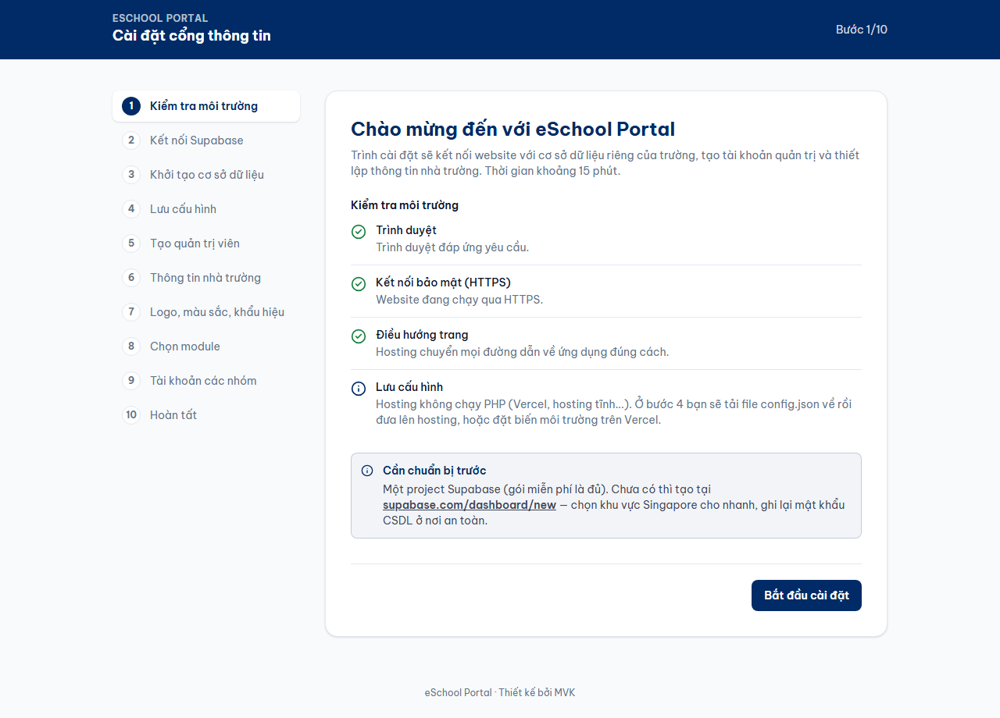
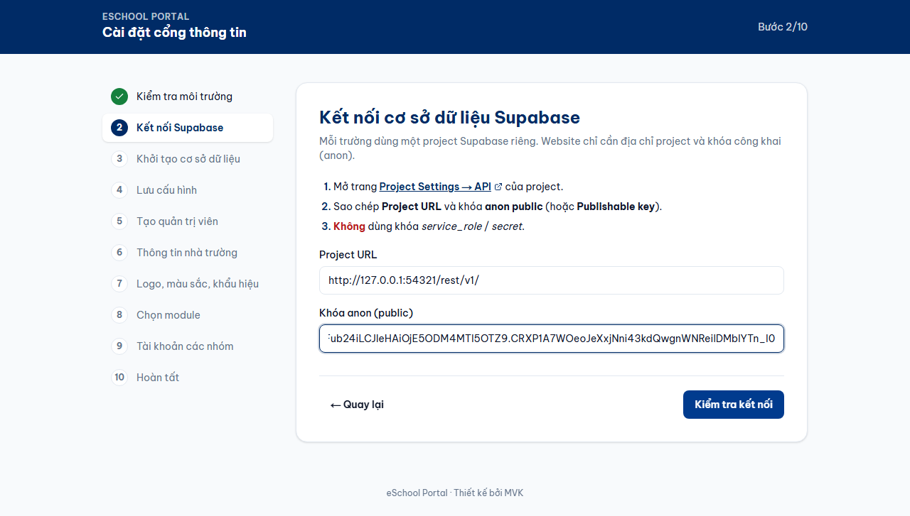
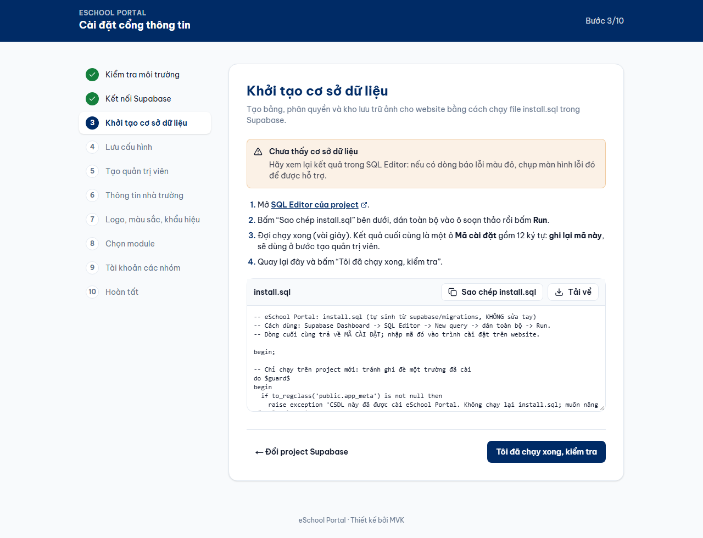
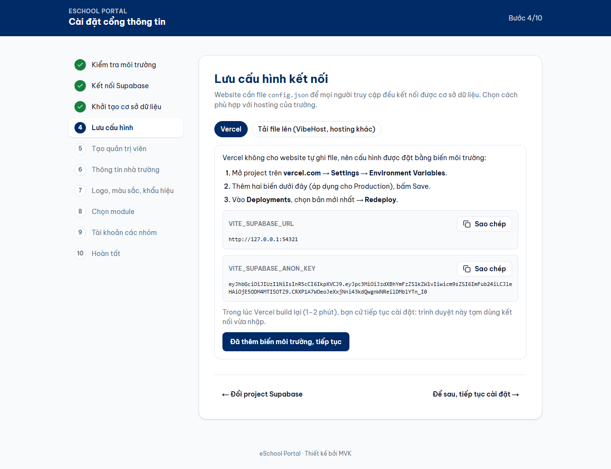
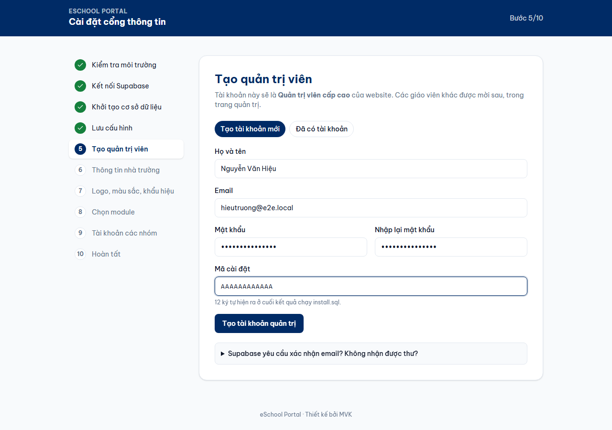
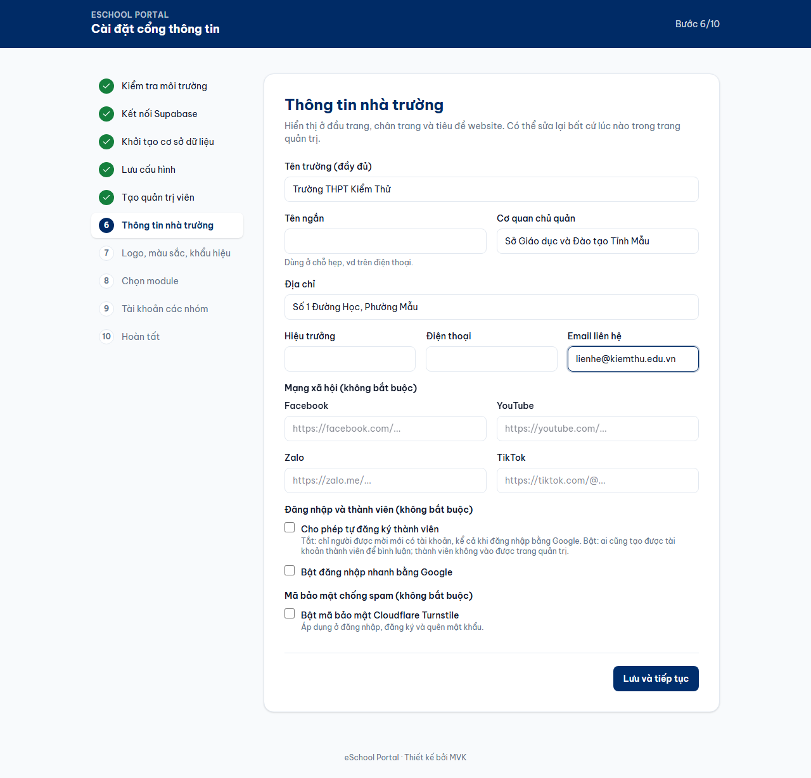
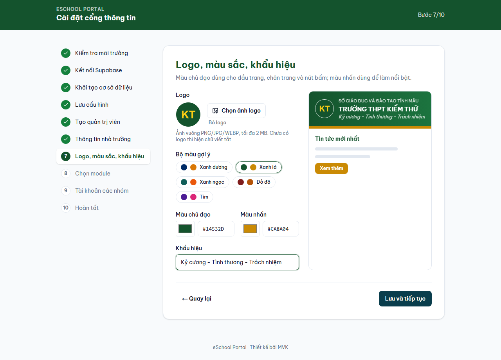
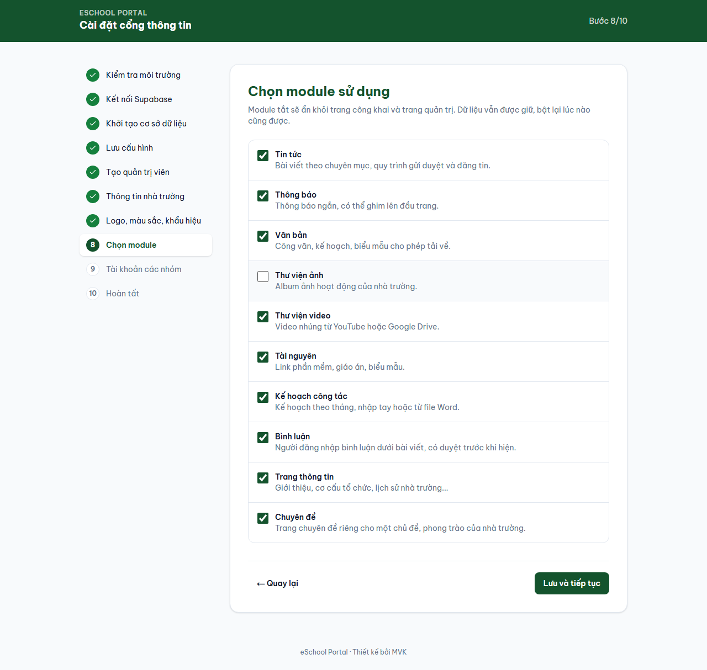
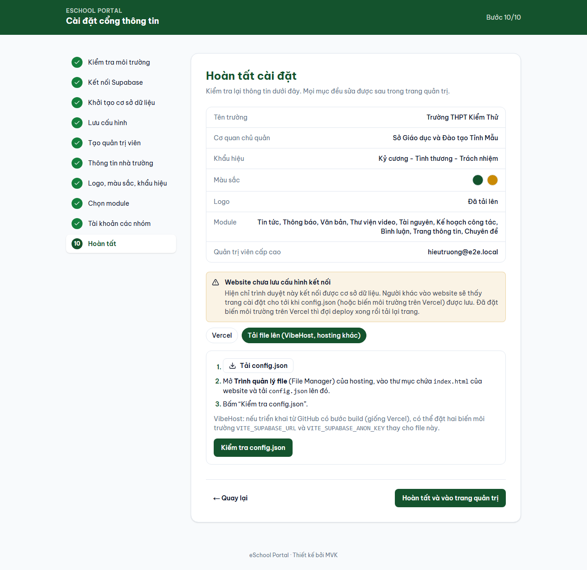

# Hướng dẫn cài đặt eSchool Portal

Tài liệu này dành cho thầy cô, nhân viên phụ trách website, không cần biết lập trình. Hãy làm lần lượt từ trên xuống. Thời gian cài lần đầu khoảng 30–60 phút.

**Nguyên tắc an toàn:** chỉ dán các khóa bí mật (Secret, service_role, mật khẩu cơ sở dữ liệu) vào đúng nơi hướng dẫn nêu. Không gửi chúng qua Zalo, email, và không dán vào website.

Giao diện của Supabase, Vercel, Google, Cloudflare có thể đổi tên menu theo thời gian. Nếu không thấy đúng chữ, hãy tìm mục có ý nghĩa tương tự.

## Phần 1. Chọn cách cài

| Cách | Phù hợp khi | Chi phí | Làm theo |
| --- | --- | --- | --- |
| **Vercel** | Chưa có hosting, muốn cập nhật dễ | Miễn phí ở mức thông thường | Phần 3A |
| **cPanel** | Trường đã thuê hosting có PHP | Theo hosting | Phần 3B |
| **VibeHost hoặc hosting có Node.js** | Đã có dịch vụ này | Theo hosting | Phần 3C |

Cách nào cũng cần một project Supabase ở Phần 2.

Bạn cần chuẩn bị:

- Một email của nhà trường để đăng ký các dịch vụ, dùng lâu dài, không nên dùng email cá nhân.
- Logo của trường (PNG hoặc JPG), tên trường, địa chỉ, số điện thoại, email liên hệ.
- Một sổ hoặc trình quản lý mật khẩu để lưu các thông tin ở các bước sau.

## Phần 2. Tạo cơ sở dữ liệu trên Supabase

Supabase là nơi lưu bài viết, tài khoản, ảnh và văn bản của trường. Mỗi trường dùng một project riêng.

1. Vào **supabase.com**, bấm **Start your project**, đăng ký bằng email của trường.
2. Bấm **New project**.
3. Điền **Project name** (ví dụ tên viết tắt của trường).
4. Bấm **Generate a password** ở ô **Database Password**, chép mật khẩu và lưu lại.
5. Ở **Region**, chọn **Southeast Asia (Singapore)** để website nhanh hơn ở Việt Nam.
6. Bấm **Create new project**, chờ vài phút tới khi project sẵn sàng.
7. Lát nữa bạn sẽ cần **Project URL** (ở **Project Settings → Data API**, hoặc nút **Connect** trên đầu trang) và khóa **anon public** hoặc **publishable** (ở **Project Settings → API Keys**). Tuyệt đối không dùng khóa **service_role** hay **secret**.

> **Gói miễn phí:** project có thể bị tạm dừng nếu 7 ngày gần như không có hoạt động, thường gặp dịp nghỉ hè. Supabase gửi email báo trước; mở trang Supabase và bấm khôi phục project là chạy lại. Nên kiểm tra email này thường xuyên.

## Phần 3A. Đưa website lên Vercel

1. Đăng nhập **github.com** (tạo tài khoản nếu chưa có).
2. Mở **github.com/maikhoa-ai-edu/eschool-portal**, bấm **Fork**, giữ dấu chọn **Copy the stable branch only**, bấm **Create fork**. Thao tác này tạo một bản sao thuộc tài khoản của bạn và về sau nhận được bản cập nhật.
3. Vào **vercel.com**, chọn **Continue with GitHub**.
4. Bấm **Add New → Project**, tìm `eschool-portal` trong danh sách, bấm **Import**.
5. Không đổi gì, bấm **Deploy**, chờ 1–3 phút.
6. Bấm vào ảnh website vừa tạo. Trình cài đặt hiện ra; chuyển sang Phần 4.

Ở bước **Lưu cấu hình**, chọn thẻ **Vercel** và làm theo hướng dẫn trên màn hình: thêm 2 biến môi trường, rồi **Redeploy**.

- **Loại biến:** nếu Vercel hỏi loại biến, chọn **Config**, không chọn loại bí mật. Vercel có thể hiện cảnh báo màu cam rằng giá trị sẽ lộ ra trình duyệt. Với hai biến này, cảnh báo đó không đáng lo vì Project URL và khóa anon vốn công khai. Nếu ô giá trị của bạn đang là khóa **service_role** hay **secret** thì phải dừng lại và đổi đúng khóa.

**Kiểm tra nhánh chạy website:** mở project trên Vercel → **Settings → Environments → Production**, mục **Branch Tracking** phải là `stable`. Nếu là nhánh khác, đổi thành `stable`, bấm **Save**, rồi **Redeploy**. Nhánh `stable` chỉ nhận các bản đã phát hành; các nhánh khác có thể chứa mã đang làm dở.

## Phần 3B. Đưa website lên cPanel

**Yêu cầu:** hosting có PHP 8.0 trở lên và website đã có HTTPS. Website phải nằm ở **gốc của tên miền hoặc tên miền phụ** (ví dụ `truong.edu.vn` hay `web.truong.edu.vn`). Không cài vào thư mục con như `truong.edu.vn/web`.

1. Giải nén gói `eschool-portal-<phiên bản>.zip` trên máy tính, bạn sẽ thấy file `dist.zip`.
2. Đăng nhập cPanel, mở **MultiPHP Manager**, chọn tên miền, đặt PHP 8.0 trở lên.
3. Mở **File Manager**, vào thư mục gốc của website (thường là `public_html`). Thư mục phải trống, nếu có website cũ hãy sao lưu và chuyển đi trước.
4. Bấm **Upload**, chọn `dist.zip`, chờ tới khi đạt 100%.
5. Quay lại File Manager, nhấp phải `dist.zip`, chọn **Extract**, xác nhận đúng thư mục `public_html`.
6. Xóa `dist.zip` sau khi giải nén.
7. Bấm **Settings** góc trên bên phải, chọn **Show Hidden Files**, bấm **Save**. Kiểm tra có file `.htaccess`. Nếu thiếu, các trang con sẽ báo lỗi 404.
8. Mở địa chỉ website. Trình cài đặt hiện ra; chuyển sang Phần 4. Ở bước **Lưu cấu hình**, website tự ghi `config.json` cho bạn.

## Phần 3C. Đưa website lên VibeHost hoặc hosting có Node.js

> Cách này chưa được kiểm chứng trên VibeHost thật. Nếu gặp khác biệt, hãy làm theo hướng dẫn của nhà cung cấp về chạy ứng dụng Node.js.

1. Giải nén `dist.zip` và tải toàn bộ nội dung lên thư mục ứng dụng, gồm cả file ẩn.
2. Đặt lệnh khởi động là `node server.mjs`, phiên bản Node.js 22 trở lên. Cổng do biến `PORT` quy định.
3. Khởi động ứng dụng, mở địa chỉ website rồi chuyển sang Phần 4.
4. Ở bước **Lưu cấu hình**, tải `config.json` về, tải lên cùng thư mục với `index.html`, rồi khởi động lại ứng dụng nếu cần.

## Phần 4. Trình cài đặt 10 bước

Trình cài đặt nhớ tiến độ, nên tải lại trang vẫn tiếp tục đúng chỗ.

### Bước 1. Kiểm tra môi trường

Bấm **Bắt đầu cài đặt**.



### Bước 2. Kết nối Supabase

Dán **Project URL** và khóa **anon public** đã thấy ở Phần 2, bấm **Kiểm tra kết nối**.



### Bước 3. Khởi tạo cơ sở dữ liệu

1. Chép toàn bộ nội dung SQL trên màn hình.
2. Mở **SQL Editor** trong Supabase, bấm **New query**, dán vào, bấm **Run**. Nếu Supabase cảnh báo về RLS (Row Level Security), chọn **Run without RLS**: đoạn SQL này tự bật RLS và tự tạo quy tắc phân quyền cho các bảng của nó.
3. Chép **Mã cài đặt** hiện ở kết quả, lưu lại để dùng ở Bước 5.
4. Quay lại website, bấm **Tôi đã chạy xong, kiểm tra**.



### Bước 4. Lưu cấu hình

Màn hình tự chọn cách phù hợp với hosting của bạn. Làm theo thẻ tương ứng.



### Bước 5. Tạo quản trị viên

Nhập họ tên, email, mật khẩu mạnh và **Mã cài đặt**. Đây là tài khoản Quản trị viên cấp cao.



### Bước 6. Thông tin nhà trường

Điền tên trường, cơ quan chủ quản, địa chỉ, liên hệ. Mục đăng nhập Google và mã bảo mật có thể để sau (xem Phần 7, 8).



### Bước 7. Logo, màu sắc, khẩu hiệu



### Bước 8. Chọn module

Bỏ chọn phần trường chưa dùng; bật lại được bất cứ lúc nào.



### Bước 9. Tài khoản các nhóm

Nhập email cho từng nhóm cần tạo. Mật khẩu ngẫu nhiên **chỉ hiện một lần**, hãy lưu lại và gửi riêng cho từng người; họ phải đổi ở lần đăng nhập đầu. Có thể bỏ qua và làm sau trong **Tài khoản**.

### Bước 10. Hoàn tất

Kiểm tra tóm tắt, bấm **Hoàn tất và vào trang quản trị**.



## Phần 5. Việc bắt buộc ngay sau khi cài

### Khai báo địa chỉ website trong Supabase

Nếu bỏ qua, liên kết trong thư quên mật khẩu sẽ không về đúng website.

1. Mở Supabase → **Authentication → URL Configuration**.
2. Đặt **Site URL** bằng địa chỉ website, ví dụ `https://truong.edu.vn`.
3. Thêm `https://truong.edu.vn/**` vào **Redirect URLs**, bấm **Save**.

### Cấu hình gửi thư (SMTP)

Máy chủ thư có sẵn của Supabase chỉ dành để thử: giới hạn rất ít thư mỗi giờ và có thể chỉ gửi tới email trong nhóm quản lý project. Nếu thầy cô cần dùng **Quên mật khẩu** hoặc trường cho phép tự đăng ký, hãy cấu hình dịch vụ gửi thư riêng:

Cách làm với Brevo (gói miễn phí 300 thư/ngày), người gửi theo tên miền của trường. Làm sau khi tên miền đã chạy (Phần 6):

1. Đăng ký **brevo.com**, chọn gói **Free**.
2. Bấm tên tài khoản → **Senders, Domains & Dedicated IPs** → tab **Domains** → **Add a domain**, nhập tên miền của trường.
   - **Branded subdomain:** để trống (không cần cho thư của website).
   - **Setup method:** chọn **Manual**.
3. Brevo hiện 4 bản ghi: TXT `@` (`brevo-code:…`), CNAME `brevo1._domainkey`, CNAME `brevo2._domainkey`, TXT `_dmarc`. Thêm từng bản ghi ở trang quản lý DNS của tên miền: ô Tên chỉ nhập phần đầu (vd `brevo1._domainkey`), ô Giá trị bấm **Copy** bên Brevo rồi dán. Không xóa các bản ghi đang có của website.
4. Đợi 10–30 phút, bấm **Verify records** rồi **Authenticate domain**.
5. Tab **Senders** → **Add sender**: tên trường, email `no-reply@<tên-miền>` (không cần hộp thư thật).
6. **SMTP & API** → tab **SMTP** → **Generate SMTP key**: Variant **Standard**, Expiry **No expiration**. Chép khóa ngay (chỉ hiện một lần), ghi lại dòng **Login**. **Không bấm** "Activate for SMTP keys" (chặn IP): Supabase gửi từ nhiều IP nên thư sẽ bị chặn.
7. Supabase → **Authentication → Emails → SMTP Settings**, bật **Enable Custom SMTP**: Sender email `no-reply@<tên-miền>`, Sender name là tên trường, Host `smtp-relay.brevo.com`, Port `587`, Username là dòng Login, Password là khóa SMTP. Bấm **Save changes**.
8. Thử bấm **Quên mật khẩu?** trên website bằng email của chính mình: thư phải đến từ `no-reply@<tên-miền>` và liên kết mở về đúng tên miền.

> Khóa SMTP của Brevo tự hết hiệu lực nếu **90 ngày liên tục** không gửi thư nào (thường gặp sau nghỉ hè). Khi thư quên mật khẩu không tới nữa: vào Brevo → **SMTP & API**, tạo khóa mới và dán lại vào ô Password trong Supabase.

### Giữ Supabase không bị tạm dừng

Gói miễn phí của Supabase tạm dừng project sau 7 ngày không có hoạt động (thường gặp vào dịp nghỉ hè, nghỉ Tết). Website có sẵn cơ chế tự gọi vào cơ sở dữ liệu mỗi ngày:

- **Vercel:** tự chạy, không cần làm gì. Kiểm tra: mở project trên Vercel → **Settings → Cron Jobs**, thấy dòng `/api/keepalive` chạy mỗi ngày.
- **VibeHost, hosting có Node.js:** `server.mjs` tự gọi mỗi ngày khi ứng dụng đang chạy.
- **cPanel:** tạo một Cron Job. Mở cPanel → **Cron Jobs**, mục **Common Settings** chọn **Once Per Day**, ô **Command** dán dòng sau (thay `truong.edu.vn` bằng tên miền của trường), bấm **Add New Cron Job**:

  ```
  curl -s -o /dev/null https://truong.edu.vn/sitemap.xml
  ```

Nếu project đã bị tạm dừng: mở Supabase, chọn project, bấm **Restore project** rồi đợi vài phút. Dữ liệu không mất.

### Tự đăng xuất

Mặc định, tài khoản tự đăng xuất khi **60 phút** không thao tác và phải đăng nhập lại sau **12 giờ** kể từ lúc đăng nhập, nên tắt máy hôm nay thì mai phải đăng nhập lại. Đổi hai con số này ở quản trị → **Thông tin trường**, mục **Tự đăng xuất**.

## Phần 6. Gắn tên miền riêng

### Trên Vercel

1. Mở project → **Settings → Domains**, bấm **Add Existing**, nhập tên miền (vd `truong.edu.vn`), bấm **Add**. Vercel tự thêm cả `www.`.
2. Chọn địa chỉ chính. Muốn địa chỉ chính không có `www`: bấm **Edit** ở dòng không có www trước, chọn **Connect to an environment → Production**, **Save**; sau đó **Edit** dòng www, chọn **Redirect to Another Domain**, **308**, chọn tên miền không có www, **Save**. Làm ngược thứ tự thì nút Save bị mờ (Vercel chặn vòng chuyển hướng).
3. Bấm **View DNS configuration** ở từng dòng, dùng tab **DNS Records** (không dùng tab Vercel DNS). Vercel cho một bản ghi **A** `@` và một bản ghi **CNAME** `www`.
4. Đăng nhập trang quản lý tên miền (vd Tenten), mục **Bản ghi DNS**, thêm đúng hai bản ghi đó (chép giá trị bằng nút sao chép của Vercel), xóa các bản ghi A/AAAA cũ của `@` và `www` nếu có.
5. Chờ tới khi Vercel báo **Valid Configuration**, thường vài phút tới vài giờ. Vercel tự cấp HTTPS.

### Trên cPanel

Trỏ tên miền về máy chủ theo hướng dẫn của nhà cung cấp, rồi bật **SSL/TLS Status → Run AutoSSL**.

### Sau khi đổi địa chỉ

Làm lại mục **Khai báo địa chỉ website** ở Phần 5: Site URL là địa chỉ chính mới, thêm `https://<địa-chỉ-chính>/**` vào Redirect URLs và giữ địa chỉ cũ một thời gian. Không cần thêm địa chỉ `www` nếu nó chỉ chuyển hướng, không thêm `localhost`. Nếu đã bật Google, thêm địa chỉ mới vào **Authorized JavaScript origins** (Phần 7). Nếu đã bật Turnstile, thêm tên miền mới vào **Hostname Management** của widget trên Cloudflare (Phần 8), nếu không trang đăng nhập sẽ báo lỗi mã bảo mật.

## Phần 7. Đăng nhập bằng Google (không bắt buộc)

1. Mở quản trị **trên tên miền chính** → **Thông tin trường**, chọn **Bật đăng nhập nhanh bằng Google**. Website hiện sẵn các địa chỉ cần chép. Chưa bấm lưu.
2. Mở **console.cloud.google.com** bằng Gmail chung của trường, tạo project mới.
3. Mở **Google Auth Platform** → **Get started**: tên ứng dụng là tên trường, email hỗ trợ, Audience **External**. Ở **Branding**, thêm tên miền của trường vào **Authorized domains**; **không tải logo** (tải logo buộc Google xét duyệt nhiều ngày). Ở **Audience**, bấm **Publish app** để mọi người dùng được.
4. Mở **Clients** → **Create client**, chọn **Web application**.
5. Dán **Authorized JavaScript origins** và **Authorized redirect URIs** từ website, bấm **Create**.
6. Mở Supabase → **Authentication → Sign In / Providers → Google**, bật lên, dán **Client ID** và **Client Secret**, bấm **Save**.
7. Trong **Authentication → URL Configuration**, thêm Redirect URL mà website hiển thị.
8. Quay lại website, dán **Client ID** vào ô tương ứng, bấm lưu.

> **Client Secret chỉ dán trong Supabase**, không dán vào website. Khi chưa bật **Cho phép tự đăng ký thành viên**, chỉ email đã được mời mới đăng nhập được bằng Google. Lỗi `redirect_uri_mismatch`: địa chỉ ở bước 5 sai, chép lại từ website. Lỗi "Access blocked": chưa **Publish app**.

## Phần 8. Mã bảo mật Cloudflare Turnstile (không bắt buộc)

1. Đăng ký **cloudflare.com**, mở **Turnstile**, bấm **Add widget**.
2. Đặt tên, thêm tên miền website, chọn chế độ **Managed**, bấm **Create**.
3. Cloudflare cấp **Site key** và **Secret key**.
4. Vào quản trị → **Thông tin trường**, bật Turnstile, dán **Site key**. Giữ trang này mở, chưa cần lưu.
5. Mở Supabase → **Authentication → Attack Protection**, bật **CAPTCHA protection**, chọn **Cloudflare Turnstile**, dán **Secret key**, bấm **Save**.
6. Quay lại website, bấm nút kiểm tra. Khi website báo **Đạt**, bấm **Lưu**. Website không cho lưu nếu chưa đạt, để tránh khai lệch làm không đăng nhập được.
7. Mở cửa sổ ẩn danh và thử đăng nhập.

> **Secret key chỉ dán trong Supabase**, không dán vào website. Không đóng trang ở bước 4 khi chưa lưu: từ lúc bật CAPTCHA trong Supabase tới lúc lưu xong, đăng nhập mới sẽ tạm thời không qua được.

## Phần 9. Sao lưu và khôi phục

**Sao lưu:** vào **Sao lưu**, bấm **Tải bản sao lưu**, cất file ZIP ở nơi an toàn. Nên làm hằng tháng và trước mỗi lần cập nhật. File không có mật khẩu nhưng có email nhân sự, không chia sẻ công khai.

**Khôi phục sang project mới:** cài website với project mới theo Phần 2–4, đăng nhập, vào **Sao lưu**, chọn file rồi xác nhận. Sau đó từng người bấm **Quên mật khẩu?** để đặt lại mật khẩu, nên cần cấu hình SMTP trước.

## Phần 10. Cập nhật khi có bản mới

Trang **Cập nhật** trong quản trị báo khi có bản mới. Dữ liệu của trường nằm trên Supabase nên không bị mất khi thay website. Hãy làm ngoài giờ cao điểm, vì từ lúc thay website tới lúc nâng cấp xong cơ sở dữ liệu, một số trang có thể tạm lỗi.

1. **Sao lưu** theo Phần 9.
2. **Thay website:**
   - **Vercel:** mở bản fork của bạn trên GitHub, bấm **Sync fork → Update branch**. Vercel tự build lại trong 1–3 phút.
   - **cPanel, VibeHost:** tải `dist.zip` từ trang phát hành, tải lên thư mục website và giải nén đè. Không xóa `config.json`. Khởi động lại ứng dụng nếu dùng Node.js.
3. **Nâng cấp cơ sở dữ liệu:** mở lại trang **Cập nhật**. Nếu cần, trang hiện đoạn SQL: bấm **Sao chép SQL**, **Mở SQL Editor**, dán, **Run** (nếu có cảnh báo RLS, chọn **Run without RLS**), rồi bấm **Tôi đã chạy xong, kiểm tra lại**. Nếu SQL báo lỗi, cơ sở dữ liệu giữ nguyên trạng thái cũ.
4. Nhấn **Ctrl + F5** để tải lại trang và kiểm tra vài trang chính.

## Phần 11. Lỗi thường gặp

| Hiện tượng | Nguyên nhân và cách xử lý |
| --- | --- |
| Trang chủ mở được, trang con báo 404 (cPanel) | Thiếu `.htaccess`. Bật **Show Hidden Files**; nếu thiếu, giải nén lại `dist.zip` |
| Website trắng hoặc lỗi khi cài vào thư mục con | Chỉ hỗ trợ gốc tên miền hoặc tên miền phụ. Chuyển sang tên miền phụ |
| Báo lỗi 500 ở `install.php`, `seo.php` | PHP dưới 8.0. Đổi trong **MultiPHP Manager** |
| Bước 2 báo đây là khóa bí mật | Bạn dán nhầm khóa `service_role` hoặc `secret`. Dùng khóa **anon public** |
| Bước 3 báo chưa thấy cơ sở dữ liệu | SQL chưa chạy hết. Chép lại toàn bộ, chạy lại trong SQL Editor |
| SQL báo "đã được cài eSchool Portal" | Project này đã cài. Không chạy lại `install.sql` |
| Không ghi được `config.json` | Thư mục không cho ghi. Dùng thẻ tải file, rồi tải lên bằng File Manager |
| Muốn cài lại trên cPanel | Xóa `config.json` và `.eschool-install.lock` bằng File Manager |
| Vercel vẫn hiện trình cài đặt sau khi thêm biến | Chưa **Redeploy**, hoặc biến chưa áp dụng cho **Production** |
| Không nhận được thư quên mật khẩu | Chưa cấu hình SMTP hoặc đã hết hạn mức thư. Xem Phần 5 |
| Liên kết trong thư mở về `localhost` | **Site URL** chưa đúng. Xem Phần 5 |
| Website báo không kết nối được dữ liệu | Project Supabase có thể bị tạm dừng. Mở Supabase và khôi phục |
| Đăng nhập báo lỗi mã xác minh | Sai **Secret key** Turnstile. Dán lại trong Supabase hoặc tạm tắt CAPTCHA protection |
| Google báo `redirect_uri_mismatch` | Địa chỉ trong Google chưa khớp. Chép lại từ trang **Thông tin trường** |
| Trang quản trị báo CSDL cần nâng cấp | Làm bước 3 của Phần 10 |
